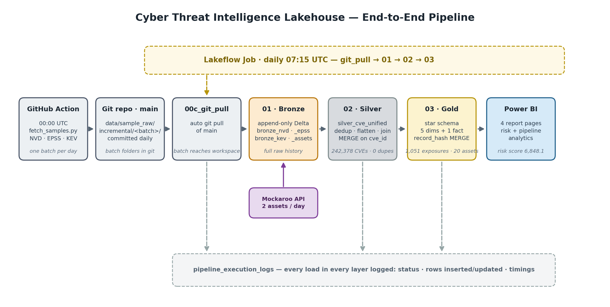
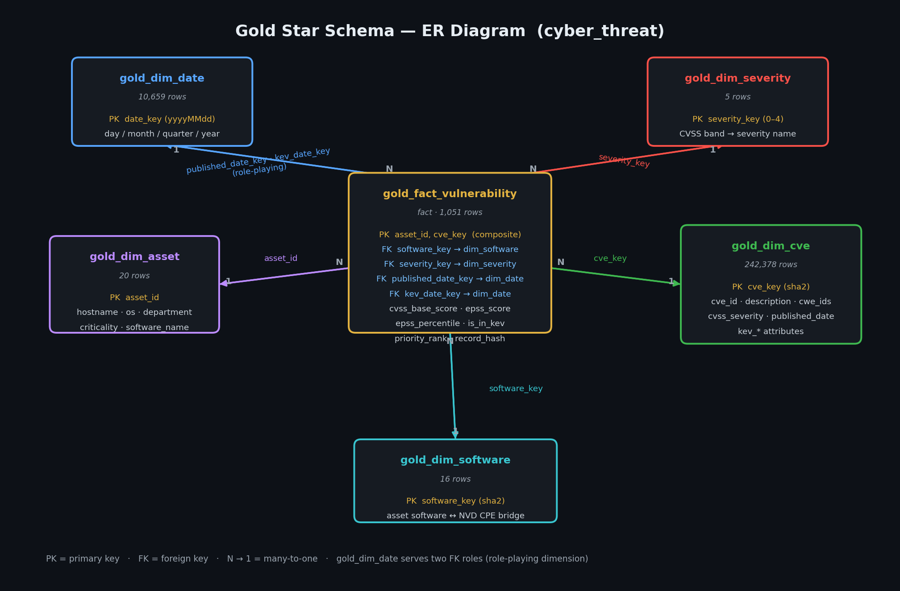

# Cyber Threat Intelligence Lakehouse

An end-to-end production lakehouse pipeline that turns raw vulnerability intelligence — NVD CVEs, EPSS exploit-likelihood scores and the CISA KEV catalog — into asset-level cyber-risk analytics. Built on Apache Spark and Delta Lake (Databricks), leveraging the Medallion architecture: GitHub → Bronze → Silver → Gold → Power BI, orchestrated end-to-end by a daily Lakeflow Job.

The pipeline ingests the vulnerability feeds into append-only **Bronze** Delta tables, MERGEs them into a deduplicated **Silver** table, and builds a **Gold** star schema (5 dimensions + 1 fact) that maps a synthetic asset inventory to real CVE exposures via NVD CPE matching with version-range checks.

**Status: COMPLETED** (semester project, team of 2. Phase 2 completed Oct 2026; Phase 3 completed Nov 10, 2026 — full status in section 18).

**Team:** Afras Shahnawaz, Rana Nauman Iqbal

**Roll no:** 24L-2547, 24L-2565

---

## 1. Architecture



**The flow:** the GitHub Action fetches NVD / EPSS / KEV daily (00:00 UTC) and commits a batch folder to `main`; the Lakeflow Job (07:15 UTC) pulls the repo and runs `00c_git_pull` → `01_landing_to_bronze` (append-only Bronze) → `02_bronze_to_silver` (dedup + MERGE on `cve_id`) → `03_silver_to_gold` (star schema, `record_hash` MERGEs) → Power BI. The Mockaroo API feeds 2 assets/day straight into Bronze. Every load in every layer writes a row to `pipeline_execution_logs` (section 8). All tables live in `<current catalog>.cyber_threat`.

## 2. Repository layout

```
notebooks/            00_config_and_logging (schemas + write_log), 00b_reset_bronze,
                      00c_git_pull, 01_landing_to_bronze, 02_bronze_to_silver,
                      03_silver_to_gold
data/sample_raw/      full_load/ + incremental/<batch>/ — one timestamped folder per daily
                      batch (epss csv, kev json, nvd json), committed by the GitHub Action
.github/workflows/     daily_incremental_fetch.yml — daily 00:00 UTC fetch + commit
fetch_samples.py       NVD / EPSS / KEV downloader (full + incremental modes)
Power BI Dashboards/   screenshots of the 4 dashboard report pages (section 16)
```

`data/sample_raw/incremental/2026-10-01_000000/` is a schema-change demo batch (section 7).

## 3. Data sources

| Source | Format | Used for |
|---|---|---|
| NVD CVE feed | JSON (wrapper object with a nested `vulnerabilities` array) | CVE details, CVSS metrics, CWE weaknesses |
| EPSS | CSV (comment header line starting with `#`) | Exploit prediction score and percentile per CVE |
| CISA KEV | JSON (wrapper object with a `vulnerabilities` array) | CVEs known to be exploited, due dates, ransomware use |
| Mockaroo assets | CSV via REST API (synthetic) | Fictional company asset inventory, matched to real CVEs in the Gold layer |

**How the raw files are produced** (`fetch_samples.py`):
- **NVD:** the full load pages through 120-day publication windows; an incremental batch contains the CVEs modified in the last 24 hours.
- **EPSS:** both full and incremental files are a complete daily snapshot, because EPSS scores shift every day.
- **KEV:** the full load is the whole CISA catalog; an incremental batch contains only entries added in the last 24 hours, so it can be empty or very small.
- **Assets:** synthetic inventory generated by Mockaroo (dataset-driven schema — section 11). The full load reads an asset CSV; the daily Lakeflow Job fetches a 2-asset feed directly from the Mockaroo API, so the CSV step logs `Skipped` for incremental batches.

## 4. Data models

### 4.1 Bronze

Bronze keeps the source structure as read with an **explicit schema** (`StructType` / `StructField`, defined in `00_config_and_logging`; `inferSchema` is never used). Every Bronze table also gets three audit columns: `load_timestamp TIMESTAMP`, `source_file STRING`, `load_type STRING`. Bronze is **append-only**: every load adds rows and nothing is updated or deleted.

Bronze has no enforced primary key because it keeps every load. Logical keys (not enforced): `bronze_nvd (id, load_timestamp)`, `bronze_epss (cve, load_timestamp)`, `bronze_kev (cveID, load_timestamp)`, `bronze_assets (asset_id, load_timestamp)`.

**`bronze_epss`**

| Column | Type |
|---|---|
| cve | STRING |
| epss | DOUBLE |
| percentile | DOUBLE |
| load_timestamp, source_file, load_type | TIMESTAMP, STRING, STRING |

**`bronze_kev`** (one row per entry of `vulnerabilities[]`)

| Column | Type |
|---|---|
| cveID, vendorProject, product, vulnerabilityName, shortDescription, requiredAction, knownRansomwareCampaignUse, forensicTriage, notes | STRING |
| dateAdded, dueDate | STRING (cast to DATE in Silver) |
| cwes | `ARRAY<STRING>` |
| load_timestamp, source_file, load_type | TIMESTAMP, STRING, STRING |

**`bronze_nvd`** (one row per `vulnerabilities[].cve`)

| Column | Type |
|---|---|
| id | STRING (the CVE id) |
| sourceIdentifier, vulnStatus | STRING |
| published, lastModified | TIMESTAMP |
| descriptions | `ARRAY<STRUCT<lang, value>>` |
| metrics | STRUCT of `cvssMetricV2`, `cvssMetricV30`, `cvssMetricV31`, `cvssMetricV40` (each an array of structs holding `cvssData`, `exploitabilityScore`, `impactScore`, ...) |
| weaknesses | `ARRAY<STRUCT<source, type, description[]>>` |
| affected | `ARRAY<STRUCT<source, affectedData[]>>` |
| references | `ARRAY<STRUCT<url, source, tags[]>>` |
| load_timestamp, source_file, load_type | TIMESTAMP, STRING, STRING |

**`bronze_assets`** (full load): `asset_id, hostname, ip_address, os_name, os_version, software_name, software_version, department, owner, criticality, exposure, environment, location, status` (all STRING) plus the three audit columns. Incremental asset files use a slimmer schema with a `change_type` column instead of the descriptive columns.

### 4.2 Silver

**`silver_cve_unified`**: one row per CVE, **primary key = `cve_id`** (enforced through the MERGE key). NVD is the base table; EPSS and KEV are left-joined on `cve_id`.

| Column | Type | Source / logic |
|---|---|---|
| cve_id | STRING | NVD `id` (EPSS `cve` and KEV `cveID` renamed to match) |
| description | STRING | English entry of NVD `descriptions` |
| cvss_v31_score / cvss_v30_score / cvss_v2_score | DOUBLE | First metric of each CVSS version |
| cvss_v31_severity / cvss_v30_severity / cvss_v2_severity | STRING | Same |
| cvss_v31_vector | STRING | CVSS v3.1 vector string |
| cvss_base_score, cvss_severity | DOUBLE, STRING | `coalesce` of v3.1, then v3.0, then v2 |
| cvss_vector | STRING | v3.1 vector |
| cwe_ids | `ARRAY<STRING>` | Flattened `weaknesses[].description[].value` |
| vuln_status, source_identifier | STRING | NVD |
| published_date, last_modified | TIMESTAMP | NVD `published`, `lastModified` |
| epss_score, epss_percentile | DOUBLE | EPSS |
| kev_date_added, kev_due_date | DATE | KEV (cast from string) |
| vendor_project, product, vulnerability_name, short_description, required_action, known_ransomware_use, kev_notes | STRING | KEV |
| kev_cwes | `ARRAY<STRING>` | KEV `cwes` |
| is_in_kev | BOOLEAN | `true` when `kev_date_added` is not null |
| silver_load_timestamp | TIMESTAMP | Time the row was built (the Silver load timestamp) |

**Deduplication before the join** (`row_number()` per `cve_id`, keep rank 1):
- NVD: newest `lastModified`, ties broken by newest `load_timestamp`
- EPSS and KEV: newest `load_timestamp`

## 5. Run instructions

**Requirements:** Databricks workspace with the repo cloned under `/Workspace/Users/<you>/cyber-threat-intel`, attached to general/serverless compute. The Lakeflow Job runs the full chain daily at 07:15 UTC (section 15); the manual flows below are for development, backfills and rebuilds.

`01_landing_to_bronze` is parameterized via three widgets (no hardcoded paths):

| Widget | Default | Description |
|---|---|---|
| `load_type` | `incremental` | `full` / `incremental` |
| `batch_id` | *(auto: oldest pending batch)* | Loads one specific incremental batch (backfill); errors if the folder doesn't exist, rejects a batch already logged as ingested |
| `repo_path` | *(your workspace clone path)* | Location of the git clone |

`02_bronze_to_silver` and `03_silver_to_gold` have no widgets: Silver always reads everything currently in Bronze; Gold always refreshes from Silver + bronze assets.

### Clean start (optional)
Run `00b_reset_bronze`. It truncates the four Bronze tables and, if `reset_log = True`, the log table too. Set `reset_log = False` to keep the log history. It does **not** touch Silver; to reset Silver as well run `DROP TABLE IF EXISTS <catalog>.cyber_threat.silver_cve_unified`.

### Full load
1. `01_landing_to_bronze` with `load_type = full`, Run all.
2. `02_bronze_to_silver`, Run all.
3. `03_silver_to_gold`, Run all.

### Incremental load (standard run)
1. `01_landing_to_bronze` with `load_type = incremental`. It automatically picks the **oldest batch folder not yet logged as successfully ingested** — the log table acts as the watermark, so already-ingested batches are never re-loaded.
2. `02_bronze_to_silver`, Run all.
3. `03_silver_to_gold`, Run all. The gold MERGEs only touch what actually changed — see section 14 for a real run.

### Daily automated run (Lakeflow Job)
The whole chain runs itself on a schedule — `00c_git_pull` (git pull) → `01` → `02` → `03` (section 15).

### Specific batch (backfill)
Loads one chosen incremental batch into Bronze at any time.
1. `01_landing_to_bronze` with `load_type = incremental` and `batch_id` set to an existing folder name. An unknown batch id raises an error; a batch already logged as ingested is rejected.
2. `02_bronze_to_silver`, Run all, then `03_silver_to_gold`.

For NVD, Silver is merged on `cve_id` and the MERGE compares `last_modified`, so an older backfilled NVD record does not overwrite a newer one. EPSS and KEV take the most recently loaded Bronze row, so backfilling an old batch after a newer one can overwrite newer EPSS scores or KEV flags.

### Silver rebuild (Bronze to Silver backfill)
Silver can be rebuilt at any time from Bronze. Bronze is append-only and holds the full load plus every incremental and backfilled batch, so recovery is:
1. `DROP TABLE IF EXISTS <catalog>.cyber_threat.silver_cve_unified`
2. Run `02_bronze_to_silver` (Run all).

The MERGE on `cve_id` recreates one row per CVE from all data in Bronze. Running it again inserts 0 rows and updates 0 rows.

> Always run Bronze first, then Silver. Silver only reads whatever is already in Bronze.

**Idempotency guarantee:** running the same batch twice produces zero duplicate rows. Bronze ingestion is watermarked by `pipeline_execution_logs` (already-ingested batches are rejected), the Silver `MERGE` only updates rows that actually changed, and every Gold `MERGE` skips rows whose `record_hash` is unchanged — re-runs are provable no-ops (0 inserted / 0 updated).

## 6. How the MERGE avoids duplicates

Silver is written by `02_bronze_to_silver` with:

```sql
MERGE INTO silver_cve_unified t
USING silver_updates s
ON t.cve_id = s.cve_id
WHEN MATCHED AND (
       s.last_modified > t.last_modified
    OR NOT (s.epss_score <=> t.epss_score)
    OR NOT (s.is_in_kev   <=> t.is_in_kev)
) THEN UPDATE SET *
WHEN NOT MATCHED THEN INSERT *
```

- `cve_id` is the merge key, so a CVE that already exists is never inserted twice.
- A matched row is only updated if something actually changed (newer NVD version, changed EPSS score, changed KEV flag). `<=>` is a null-safe comparison.
- Bronze can contain repeated rows (it is append-only and EPSS is a full snapshot every day), but the dedup step reduces each source to one row per CVE before the MERGE.
- The notebook ends with a duplicate check (`total rows` vs `distinct cve_id`) and logs the real inserted/updated counts taken from Delta's MERGE metrics.

**Re-running the same load inserts 0 rows and updates 0 rows.**

## 7. Schema change handling

- All sources are read with explicit schemas, so types are enforced and nothing is inferred. The schemas can be printed with `printSchema()` at the end of `01_landing_to_bronze` (Bronze) and `02_bronze_to_silver` (Silver).
- **EPSS** has drift detection (`csv_header()` and `detect_drift()` in `01_landing_to_bronze`): the incoming file's header is compared with the expected schema before loading.
  - **New columns** are kept, read as STRING, and added to `bronze_epss` with `mergeSchema`.
  - **Missing columns** are filled with NULL.
  - Every change is written to the log table with `status = 'Schema Change'` and the details in `error_message` (e.g. `added=['epss_trend'] | missing=[]`).
- KEV, NVD and asset files are read with their explicit schemas; unexpected extra fields in them are ignored rather than detected.
- Values that cannot be cast to the schema type become NULL instead of crashing the batch.
- Silver selects its columns explicitly, so a new Bronze column does not automatically appear in Silver. It has to be added on purpose.

**Try it yourself:** the batch `2026-10-01_000000` contains an EPSS file with an extra `epss_trend` column. Load it with `load_type = incremental`, `batch_id = 2026-10-01_000000`: the log records a `Schema Change`, `bronze_epss` gains the column, and KEV/NVD/assets log `Skipped` (no files for them in this batch). Normal incremental runs skip this folder (it sorts before the real batches); don't run `02_bronze_to_silver` after it.

## 8. Log table: `pipeline_execution_logs`

One row per load of one source into one table.

| Column | Meaning |
|---|---|
| run_id | UUID per source load |
| layer | `Raw-to-Bronze`, `Bronze-to-Silver`, `Silver-to-Gold`, or `Orchestration` (git pull) |
| load_type | `full`, `incremental`, `backfill`, or `merge` (Silver) |
| source_param | Source file name (or `bronze_*` for Silver) |
| target_table | Table written |
| start_time, end_time, load_timestamp | Timing |
| status | `Success`, `Failure`, `Skipped`, or `Schema Change` |
| rows_inserted, rows_updated | Row counts (Silver values come from the MERGE metrics) |
| error_message | Error text, skip reason, or schema change details |

`Skipped` is logged when an incremental/backfill batch has no file for a source (assets, KEV or NVD). Failures are logged and then re-raised.

## 9. Results from our runs

| Step | Silver MERGE result | Silver rows | Duplicates |
|---|---|---|---|
| Full load | 500 inserted, 0 updated | 500 | 0 |
| Re-run of the same MERGE | 0 inserted, 0 updated | 500 | 0 |
| Incremental batch `2026-10-10_045631` | 1,177 inserted, 0 updated | 1,677 | 0 |
| Re-run | 0 inserted, 0 updated | 1,677 | 0 |
| Backfill batch `2026-10-09_185004` | 1,188 inserted, 0 updated | 2,865 | 0 |
| Re-run | 0 inserted, 0 updated | 2,865 | 0 |
| Schema change batch `2026-10-01_000000` (extra `epss_trend` column) | Logged as `Schema Change`, column added to `bronze_epss`, KEV/NVD/assets `Skipped` | n/a | n/a |
| Rejected-CVE cleanup (2026-10-24) | −9,930 rows via guarded one-time DELETE (silver 249,305 → 239,375) | 239,375 | 0 |
| Incremental batch `2026-10-13_060009` (2026-10-24) | ≈1,988 inserted, ≈3,377 updated | ≈241,363 | 0 |
| Gold initial build (2026-10-24) | fact 1,023 rows / 20 assets / 695 CVEs, 0 orphan FKs | n/a | 0 |
| Gold refresh after the same batch (2026-10-24) | fact +8 inserted / 3 updated → 1,031 rows / 702 CVEs | n/a | 0 orphan FKs |
| Lakeflow Job run, batch `2026-10-16_034138` (2026-11-10, section 15) | 1,015 inserted, 14,094 updated; gold fact → 1,051 rows / 714 CVEs | 242,378 | 0 |

---

## 10. Gold layer — star schema

`notebooks/03_silver_to_gold` builds the star schema in `<catalog>.cyber_threat`. Every table is loaded through `merge_dimension()` (cell 4), a reusable MERGE loader: it creates the table if missing, rebuilds it once if an older schema without `record_hash` is found, and MERGEs with change detection via `record_hash = sha2(all business columns)` — re-runs are provable no-ops (0 inserted, 0 updated) unless data actually changed. Inserted/updated counts come from Delta's `DESCRIBE HISTORY` MERGE metrics and are logged to `pipeline_execution_logs` under `layer = 'Silver-to-Gold'` with timings.

### 10.1 Data dictionary

**`gold_fact_vulnerability`** — the fact table. Grain: one row per **(asset_id, cve_key)** = one CVE exposure of one asset's software. Composite PK (asset_id, cve_key).

| Column | Type | Meaning |
|---|---|---|
| asset_id | STRING | FK → gold_dim_asset (part of PK) |
| cve_id | STRING | Natural key, denormalized for readability |
| cve_key | STRING | FK → gold_dim_cve (part of PK), sha2(cve_id) |
| software_key | STRING | FK → gold_dim_software (the CPE mapping that matched) |
| severity_key | INT | FK → gold_dim_severity (CVSS band) |
| published_date_key | INT | FK → gold_dim_date (role-playing: CVE published date, yyyyMMdd) |
| kev_date_key | INT | FK → gold_dim_date (role-playing: KEV date added; NULL if not in KEV) |
| cvss_base_score, epss_score, epss_percentile | DOUBLE | Measures |
| is_in_kev | BOOLEAN | Measure: actively exploited flag |
| priority_rank | INT | Derived measure: 1 = in KEV, 2 = EPSS ≥ 0.5, 3 = CVSS ≥ 9.0, 4 = rest |
| record_hash, gold_load_timestamp | STRING, TIMESTAMP | Change detection + load time |

**`gold_dim_cve`** (≈241k rows) — PK `cve_key` (sha2 of cve_id). One row per CVE in silver: description, `cwe_ids` array, `vuln_status`, `cvss_severity`, `cvss_vector`, `published_date`, `last_modified`, `source_identifier`, and KEV attributes (`kev_vendor_project`, `kev_product`, `kev_vulnerability_name`, `kev_description`, `kev_required_action`, `known_ransomware_use`, `kev_date_added`, `kev_due_date`).

**`gold_dim_asset`** (20 rows) — PK `asset_id`. Inventory attributes: hostname, ip_address, os_name, os_version, software_name, software_version, department, owner, criticality, exposure, environment, location, status. Built latest-wins per asset_id (`row_number()` over bronze `load_timestamp` desc) so append-only bronze duplicates collapse deterministically.

**`gold_dim_software`** (16 rows) — PK `software_key` (sha2 of name:vendor:product). The bridge between asset `software_name` and NVD's CPE `vendor:product`. Carries both CPE spellings where NVD uses two (Nginx → `nginx:nginx` and `f5:nginx`), and points MySQL at `oracle:mysql` (`mysql:mysql` has zero matches in our NVD data).

**`gold_dim_date`** (10,656 rows) — PK `date_key` (yyyyMMdd int). Daily calendar spanning the union of silver's published / last_modified / kev_date_added / kev_due_date range (1997 → 2026) with day/month/quarter/year attributes. Serves two FK roles (published_date_key, kev_date_key) — classic role-playing dimension.

**`gold_dim_severity`** (5 rows) — static reference. severity_key 0–4 → UNKNOWN / LOW / MEDIUM / HIGH / CRITICAL with CVSS bands (0.1–3.9, 4.0–6.9, 7.0–8.9, 9.0–10.0).

### 10.2 ER diagram



Five dimensions around one fact; `gold_dim_date` serves two FK roles (published + KEV dates) — a role-playing dimension.

### 10.3 How the fact is derived (pipeline-true relationships)

No CVE is hand-assigned to any asset. Every fact row is derived:
1. Explode NVD `configurations → nodes → cpeMatch` from bronze_nvd (one row per CVE × CPE criterion, `vulnerable = true` only).
2. Split the CPE criteria string `cpe:2.3:a:<vendor>:<product>:<version>` into vendor/product/version plus the four bounds (versionStart/End Excluding/Including).
3. Join `gold_dim_software` on (cpe_vendor, cpe_product) and `gold_dim_asset` on software_name.
4. Version-range check UDF (cell 10): compares the asset's version against the CPE pin/bounds — dotted versions ('2.4.49'), exact pins, and all four bound types; tolerant of odd formats ('9.6p1', '2019').
5. Join silver for measures (cvss, epss, kev), compute surrogate keys + severity band + priority_rank, dedup on (asset_id, cve_key), then the idempotent MERGE.

CPE was chosen over the newer `affected` field because CPE covers ~95% of our NVD data vs ~60–70% for `affected` (verified by sampling).

Rejected CVEs never reach gold: silver filters `vuln_status = 'Rejected'` (null-safe) in 02 cell 5; a one-time guarded DELETE purged 9,930 historical rows (silver 249,305 → 239,375) and remains as a no-op guard for other workspaces.

### 10.4 Current gold numbers (2026-11-10)

| Table | Rows |
|---|---|
| gold_fact_vulnerability | 1,051 (714 distinct CVEs, 20/20 assets, 0 orphan FKs) |
| gold_dim_cve | 242,378 |
| gold_dim_date | 10,659 |
| gold_dim_asset | 20 |
| gold_dim_software | 16 |
| gold_dim_severity | 5 |

Severity mix (fact rows): 99 CRITICAL / 341 HIGH / 542 MEDIUM / 69 LOW. Six assets carry KEV exposures.

Top exposures by software: MySQL 8.0.0 = 376, Apache 2.4.49 / 2.4.50 / 2.4.58 = 88 / 86 / 67 (all KEV-exposed — path-traversal era), Tomcat 9.0.0 / 8.5.0 = 87 / 60 (KEV), MySQL 5.7.9 = 56, Node.js 16.0.0 / 18.0.0 = 40 / 37 (18.0.0 KEV), PostgreSQL 12.1 = 31, Redis 6.0.0 / 5.0.0 = 29 / 28, MS SQL Server 2019 = 21.

## 11. Asset inventory (Mockaroo)

- **Source:** Mockaroo REST API (`https://my.api.mockaroo.com/api/v1/assets`, X-API-Key header; key held by the team, not committed). The daily job fetches a 2-row feed on every incremental run and appends it to `bronze_assets` (logged as source `mockaroo_assets_api`).
- **Dataset-driven schema:** `asset_id`, `hostname`, `software_name`, `software_version`, `os_name`, `os_version` all draw from the same row of a curated 20-row dataset on mockaroo.com, so combinations are always coherent (no `MySQL @ 9.6p1`) and identities are stable forever — Mockaroo's row-number ids would otherwise restart at 1 every fetch, making `AST-001` a different machine each day.
- **Vulnerable-era versions:** software is pinned to versions that land inside real NVD CPE ranges — Apache 2.4.49/2.4.50 (KEV path-traversal CVE-2021-41773 / CVE-2021-42013) vs 2.4.58 as the patched twin, MySQL 5.7.9/8.0.0, Tomcat 9.0.0/8.5.0, Node.js 16/18, PostgreSQL 12.1/9.6.0, Kubernetes 1.24/1.28, MS SQL 2019, OpenVPN 2.4.0, Redis 6.0.0/5.0.0, Docker 20.10.0, Logstash 7.0.0, Prometheus 2.30.0.
- **Deterministic gold:** duplicate fetches collapse via `dim_asset`'s latest-wins pick + `record_hash`; the daily 2-row feed is an attribute refresh of one of the 20 stable identities. Gold MERGEs cannot delete, so a full asset replacement uses an overwrite rebuild.
- **Column-order gotcha (reproducibility):** schema-enforced Spark CSV reads map columns **by position, not name**, and the API's column order differs from `asset_schema` — every fetch maps columns **by name** before writing (caught when an unreordered fetch shifted columns and produced 0 fact rows).

## 12. Decision log

| # | Decision | Rationale |
|---|---|---|
| 1 | Bronze append-only | Raw, replayable history; silver/gold dedup makes repeated loads harmless |
| 2 | Silver = MERGE on `cve_id` | NVD base + EPSS/KEV left-join enrichment; MERGE cost scales with the changed fraction, not table size |
| 3 | Rejected CVEs filtered at bronze→silver, not in bronze | Bronze stays faithful to the raw source; silver is the clean analysis universe |
| 4 | Gold = MERGE + `record_hash` (sha2 of business columns) | Idempotent SCD-1-style loads; re-runs are provable no-ops (0/0); metrics from Delta `DESCRIBE HISTORY` feed the log |
| 5 | Surrogate keys via sha2 (`cve_key`, `software_key`) | Stable, join-safe, no sequence coordination; `date_key`/`severity_key` are small deterministic ints |
| 6 | Star schema, not snowflake | Denormalized single-hop joins for BI; severity and date split out as conformed reference dims; date serves two role-playing FKs |
| 7 | Asset↔CVE exposures derived from NVD CPE + version checks, never hand-assigned | Pipeline-derived and reproducible; the version comparator rejected nonsense combos that would otherwise inflate the fact |
| 8 | `dim_software` mapping table | Decouples Mockaroo display names from NVD CPE spellings |
| 9 | `dim_asset` latest-wins by `load_timestamp` | Deterministic pick among bronze duplicates; identical re-sends are no-ops |
| 10 | No physical partitioning | Table sizes don't justify partition columns (small-file risk); OPTIMIZE / liquid clustering applied instead (section 17) |
| 11 | PII: inventory fully synthetic (Mockaroo) | No real PII ingested; no credentials committed; Databricks auth is workspace-native |
| 12 | Explicit schemas everywhere; EPSS drift detection | Types enforced, nothing inferred; schema changes logged (section 7) |
| 13 | `03a_gold_dimensions` consolidated into `03_silver_to_gold` | Best-of-both merge of the two implementations; git history retains it |
| 14 | Log table as ingestion watermark | Incremental runs pick the oldest batch not yet logged as ingested — no state beyond the log |

## 13. End-to-end incremental run (batch `2026-10-13_060009`)

The full chain on a real batch:

| Step | Result |
|---|---|
| 01 → bronze (oldest pending batch) | EPSS +385,987 rows; NVD +5,370 CVEs; KEV +0 (batch had none); assets `Skipped` (no asset file in batch) |
| 02 → silver (MERGE) | ≈1,988 CVEs inserted, ≈3,377 updated (fresh EPSS scores) |
| 03 → gold | dim_cve +1,988 / 3,377 updated; dim_date +2; dim_asset, dim_software, dim_severity all 0/0 (no-ops); fact +8 inserted / 3 updated → 1,031 rows |

Every step logged with row counts and timings; idempotence verified (unchanged dims merge at 0/0). The same chain runs on the daily Lakeflow Job schedule (section 15).

## 14. Spark execution notes

Measured from the physical plan (`explain("formatted")`) of the fact build (03 cell 10) on serverless compute (Photon + AQE), captured 2026-10-24.

**The row funnel:** bronze_nvd 251,298 distinct CVEs → `explode_outer` over `configurations → nodes → cpeMatch` produces **1,162,904** CPE criteria rows → software-mapping joins + Python UDF version check + silver join + dedup → **1,031** fact rows (≈1,130 CPE rows per fact row).

**How Spark executed it (per the physical plan):**
- **Scan with column pruning + predicate pushdown:** the bronze_nvd Parquet scan outputs only 2 of the table's columns (`id`, `configurations`), with `isnotnull(id)` pushed down as a `RequiredDataFilter` — pruning and pushdown happen at the source.
- **Generate (explode):** three chained `PhotonGenerate` operators expand configurations → nodes → cpeMatch.
- **Shuffles (3):** (1) `dropDuplicates(cve_id)` compiles to a `first()` hash aggregate with a hash-partition exchange on `cve_id`; (2) the silver join shuffles silver's side on `cve_id` (`PhotonShuffledHashJoin`); (3) the final `dropDuplicates(asset_id, cve_key)` aggregates with another exchange.
- **Broadcast hash joins:** `gold_dim_software` (16 rows) and `gold_dim_asset` (20 rows) are broadcast (`PhotonBroadcastHashJoin`) — Spark skips shuffles entirely for the small dimensions because they are under the broadcast threshold.
- **Python UDF barrier:** `ArrowEvalPython` runs the version comparator in columnar Arrow batches after the broadcast joins (on the already-reduced row set) but before the silver join. The UDF is a black box to Catalyst — no predicate pushdown can cross it, so all 1.16M exploded rows must be materialized and shipped to Python before the filter. A native Spark expression would let the optimizer prune earlier; the trade-off was deliberate (version semantics like `9.6p1` are far easier to get right in Python, and the UDF runs post-join on a much smaller stream).
- **Engine:** the plan executes as an `AdaptiveSparkPlan` under **Photon** (serverless vectorized engine), then the MERGE write runs via `merge_dimension()`.

**Reproducibility proof (2026-10-24):** rebuilding the fact from scratch with identical logic reproduces exactly 1,031 rows with 0 rows in the target unexplained by the fresh build — the fact is a deterministic function of bronze + silver + dims.

**The DAG in one line:** Parquet scan (2 cols, pushdown) → Generate ×3 → shuffle (cve dedup) → broadcast joins → ArrowEvalPython UDF → shuffle (silver join) → dedup aggregate → MERGE write (capture it from the Spark UI of cell 10 in `03_silver_to_gold`).

---

## 15. Automated daily orchestration (Lakeflow Job)

The pipeline runs itself end-to-end on a daily schedule.

**Job:** `Cyber Threat Intel Daily Pipeline` (Lakeflow Job, serverless compute, linear task chain, max 1 concurrent run, failure email to the team).

| # | Task | Notebook | Parameters |
|---|---|---|---|
| 1 | `git_pull` | `notebooks/00c_git_pull` | — |
| 2 | `bronze` | `notebooks/01_landing_to_bronze` | `load_type=incremental`, `repo_path=/Workspace/Users/<you>/cyber-threat-intel`, `batch_id` empty (auto = oldest pending batch) |
| 3 | `silver` | `notebooks/02_bronze_to_silver` | — |
| 4 | `gold` | `notebooks/03_silver_to_gold` | — |

- **Schedule:** daily at 07:15 UTC (`0 15 7 * * ?`), unpaused. The GitHub Action fetches at 00:00 UTC but only commits the batch at ~03:45–06:30 UTC (NVD/EPSS fetching takes hours), so the job runs after the batch is guaranteed to be on `main` — a 00:xx run would pull yesterday's state.
- **How the auto git pull works:** `00c_git_pull` resolves the workspace git folder by path (each teammate's clone has a different repo id) and updates the checkout to the latest commit of `main` through the Repos API (a same-branch update is the documented pull). Remote commits only ever add `data/` files, so uncommitted local notebook edits never conflict. Every pull is logged to `pipeline_execution_logs` (`layer = 'Orchestration'`, `load_type = 'git_pull'`) without touching the batch watermark.
- **Assets in the daily run:** incremental batches carry no asset file, so on every incremental run `01_landing_to_bronze` also fetches the 2-asset feed from the Mockaroo API — a driver-side request whose columns are mapped **by name** (the API's column order differs from `asset_schema`; see section 11), drift-detected, appended to `bronze_assets` and logged as source `mockaroo_assets_api`. Gold's latest-wins `dim_asset` + `record_hash` make the daily 2-row churn deterministic.

**Run 786888018754119 (2026-11-10) — SUCCESS, ~4 min end-to-end, 13 log entries, every status `Success` or `Skipped`:**

| Task | Result |
|---|---|
| git_pull | pulled `main` to 0fa48bc0 |
| bronze | batch `2026-10-16_034138`: EPSS +389,824, KEV +1, NVD +7,499; assets CSV `Skipped`; Mockaroo API +2 assets |
| silver | MERGE 1,015 inserted / 14,094 updated → 242,378 rows, 0 duplicates |
| gold | dim_cve 1,015/2,062, dim_date +3, dim_asset 0 inserted / 2 updated (Mockaroo attribute churn), dim_software & dim_severity 0/0 no-ops, fact +20 inserted / 88 updated → 1,051 rows (714 CVEs, 20 assets, 0 orphan FKs) |

The log table carries `write_log` coverage across all four layers (Orchestration, Raw-to-Bronze, Bronze-to-Silver, Silver-to-Gold) and doubles as the job's run graph.

## 16. Dashboards & business intelligence

Connected to the six gold tables through a Databricks SQL warehouse on the workspace's Unity Catalog. The semantic model mirrors the star schema: fact measures (`cvss_base_score`, `epss_score`, `epss_percentile`, `is_in_kev`, `priority_rank`) plus dimension attributes for slicing (`dim_asset`: department, criticality, exposure, os_name; `dim_date` role-playing date keys).

Every measure was verified against Spark ground truths computed directly on the gold tables at build time — total risk score 6,848.1 across the then-1,031 exposures (11 KEV exposures, avg 6.64/exposure), top host `mysql-prod-02` at 1,936.5, top OS `RHEL` at 2,636.2 — and the visuals keep tracking the tables as the daily job loads more batches.

Full-resolution screenshots are in `Power BI Dashboards/`.

### Executive summary — KPI cards + risk-quadrant scatter (CVSS vs EPSS)


### Remediation — act-now priorities + KEV timeline


### Assets & software — hostname / OS risk rankings


### Pipeline operations — run history from `pipeline_execution_logs`


---

## 17. Cost & FinOps

**Measured compute time** (from `pipeline_execution_logs`, Oct 24): all 33 logged pipeline steps of the day total **275 s**. Per layer: Silver-to-Gold 27 steps / 225 s (avg 8.3 s; max 21 s = full fact build, 16 s incremental), Raw-to-Bronze 5 steps / 36 s (max 18 s = NVD batch), Bronze-to-Silver full-bronze MERGE 14 s.

**A typical daily incremental run** (batch `2026-10-13_060009`): Bronze 27 s (EPSS 6 + KEV 3 + NVD 18) + Silver MERGE 14 s + Gold refresh 63 s ≈ **104 s (~1.7 minutes)** of active serverless compute.

**Measured consumption** (`system.billing.usage` × `list_prices`, last 7 days): **4.1 DBUs ≈ $1.18 total** — serverless interactive compute 1.335 DBU (≈$1.00), storage ≈$0.006, networking negligible. (2.4 DBU of Genie AI usage is assistant overhead, not pipeline.) The entire project to date — full loads, silver rebuilds, asset swap, dozens of runs — cost about a dollar; a single daily incremental run is on the order of a cent.

**At enterprise scale** (hourly for a year = 8,760 runs ≈ 290 compute-hours), student-scale data would still cost only low hundreds of dollars at serverless rates. The real cost drivers at scale are two super-linear patterns: (1) **EPSS publishes a full snapshot (~385k rows) every cycle** — hourly ingestion would append ~9M rows/day to append-only bronze forever; (2) **`02_bronze_to_silver` re-reads all of bronze on every run** — O(total history) per run even when the daily change is a few thousand rows.

**Optimizations** (3-5 in place; 1-2 are the scale-up levers):
1. **EPSS diffing** — ingest only changed (cve, epss) pairs per cycle; cuts bronze growth ~99%.
2. **Incremental silver** — process only batches newer than a watermark (the log table already tracks what is ingested); drops per-run cost from O(history) to O(daily change).
3. **MERGE + record_hash change detection (in place)** — silver/gold rewrites stay proportional to the changed fraction, not table size.
4. **Lakeflow Job orchestration (in place)** — scheduled runs with retries/alerts, no human-driven sessions (section 15).
5. **OPTIMIZE / liquid clustering (in place)** — `gold_dim_cve` liquid-clustered on `published_date` (3 → 2 files), `gold_fact_vulnerability` compacted (2 → 1 file, 88,287 → 83,168 bytes); row counts and keys verified identical before/after — layout-only change, MERGE loads unaffected.

## 18. Status: COMPLETE

**Phase 2** (completed Oct 2026):
- ✅ Bronze ingest (`01_landing_to_bronze`) — full / incremental / backfill loads, explicit schemas, EPSS schema-drift detection
- ✅ Silver unify (`02_bronze_to_silver`) — dedup, flatten, left-join, MERGE on `cve_id`, rejected-CVE filtering
- ✅ Audit logging (`pipeline_execution_logs`) with row counts and timings for every load
- ✅ Daily raw-fetch automation (GitHub Action, 00:00 UTC)

**Phase 3** (completed Nov 10, 2026):
- ✅ Gold star schema (`03_silver_to_gold`) — 5 dims + fact, idempotent `record_hash` MERGEs, role-playing date keys, CPE-derived exposures (sections 10, 13)
- ✅ Data dictionary & ER diagram (section 10)
- ✅ Automated daily orchestration (Lakeflow Job: `00c_git_pull` → `01` → `02` → `03`, daily 07:15 UTC — section 15)
- ✅ Daily Mockaroo asset feed via API (2 assets/day, section 11)
- ✅ Power BI production dashboards — 4 report pages, measures verified against Spark ground truths (section 16)
- ✅ Spark DAG analysis (section 14) & FinOps evaluation (section 17)
- ✅ Lakehouse optimizations — liquid clustering on `gold_dim_cve`, OPTIMIZE on the fact (section 17)
- ✅ Final report — compiled from this README (sections 1, 12, 14, 17)